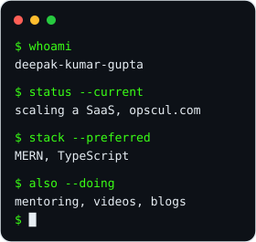

---

  I believe code should be as thoughtful as the product it powers, and that the best software disappears into the experience it creates.

  

  
  
  

  
  
  
  

---

### 🚀 **About Me**

- 💼 **Software Engineer** at **CultureX**, on the **MERN** stack
- 🚀 **Co-Founder & Engineer** at **[Opscul](https://opscul.com)**, building and selling a school management SaaS, full-stack
- 🎓 B.Tech, Computer Science and Engineering, Radharaman Institute of Technology & Science, Bhopal
- 📚 Sharpening **Java** and **DSA** alongside day-to-day engineering
- 🔢 Day to day, I build things with **data** using **JavaScript**
- 💬 Ask me about React, Node.js, MongoDB, or taking a SaaS from idea to paying customers
- ⚡ Fact: I'm not anti-social, I'm just not ~~User-friendly~~

I believe great software is not just built, it's refined through continuous improvement, collaboration, and attention to detail. From performance optimization to clean architecture, I care about how products scale, perform, and feel to real users.

---

### 🌐 **My Digital Life**

<table>
<tr>
<td width="260" valign="top">
  
</td>
<td valign="top">

I'm into JavaScript, React and the MERN stack, with an eye on whatever's coming next. I write regular blog posts at [codingroar.com](https://codingroar.blogspot.com), and make videos about things I'm familiar with, things that trip up people I mentor, and things I'm learning myself.

💌 Sign up for [Coding Tutorials](https://youtube.com/c/CodingClasses/) on my channel.

<strong>🎬 A couple of favorite builds</strong>

 

<table>
<tr>
<td align="center" width="50%">
  <a href="https://deepakhere.github.io/Ecom">
     
    <strong>Ecom</strong>, an e-commerce build
  </a>
</td>
<td align="center" width="50%">
  <a href="https://youtu.be/fJdiJqzczN8/">
     
    <strong>Watch on YouTube</strong>
  </a>
</td>
</tr>
</table>

> On a mission to fuel my dream of tech and talent.

</td>
</tr>
</table>

---

### 🧩 **Opscul, my own product**

<table>
<tr>
<td width="100%">

**[opscul.com](https://opscul.com)** · a school management SaaS I co-founded and engineer end to end

Replaces WhatsApp groups, paper registers and fee ledgers with one connected system for schools, web and mobile. Attendance, homework, notices, fees, exams and parent-teacher communication, for admins, teachers and parents.

`Express` `MongoDB` `React` `React Native` · free for 30 days, no card required

</td>
</tr>
</table>

---

### 🧰 **Skill Stack**

  
  
  
  
  
  
  
  
  
  
  
  
  
  
  
  

---

### 🎓 **Education**

**B.Tech, Computer Science and Engineering** 
Radharaman Institute of Technology & Science, Bhopal · Oct 2021 – Jun 2024 
Specialization in full-stack development, with a focus on scalable, user-centric web applications.

**Diploma, Computer Engineering** 
Jharkhand University of Technology (JUT), Ranchi · Aug 2018 – Oct 2021

---

### 📊 **GitHub Stats**

  
  

  

---

  

  

